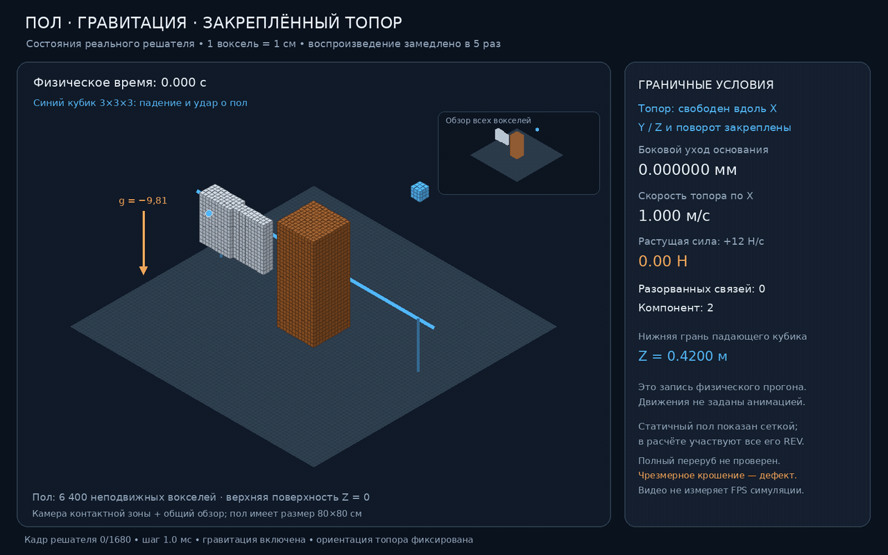

# Voxel Physics Lab

An experimental Rust voxel mechanics sandbox. Matter is represented as 1 cm
representative volumes joined by directional bonds. The project explores how
contact, material orientation, deformation, and bond failure can produce cutting
and fracture without tool-specific damage scripts. It is a prototype, not a
validated continuum simulator.

## Current results

- Wood REVs carry a local grain orientation. For vertical grain (`Z`), the
  example material table sets bond limits to 100 MPa tension, 50 MPa compression
  and 12 MPa shear along the grain; across the grain the limits are 2.5 MPa,
  2 MPa and 3 MPa. The corresponding directional stiffness uses the same grain
  axis. Fracture surface work is also directional: the example uses 350 J/m²
  along grain and 80 J/m² across it. These are illustrative inputs, not
  species-calibrated values.
- Displacement-controlled 10³-REV tests measure parallel/transverse force
  ratios of 39.458 in tension and 32.539 in compression. The bond regression
  checks real vertical and horizontal neighbors, including shear limits.
- The voxelized blade has a beveled one-REV edge. Its collision impulse and
  friction load the same bond stress law used by other materials.
- Any finite-mass voxel can receive a persistent world-space force or
  acceleration, a one-time impulse, or a directly assigned initial velocity.
  These inputs enter the same coupled solve, contact projection, and bond
  fracture path; persistent inputs remain active until cleared.
- Rigid voxel groups also accept persistent external force and torque, so an
  applied push can act through the body's mass and inertia.
- Corotational passes have a convergence-based early exit; they stop only when
  both orientation change and the linear-solver residual meet their configured
  tolerances. The configured pass count remains the maximum.
- A free REV under constant force reaches 1.000 m/s after 100 ms within
  3.2×10⁻⁵ m/s; two moving REVs collide without overlap and conserve momentum.
- An experimental strike-pitch parameter is available in the capture tool;
  nonzero-pitch collision stability still needs validation.

### Applying motion to voxels

The public `solver` API accepts inputs by voxel index, without material- or
tool-specific branches:

```rust
solver::set_force(&mut scene, voxel, Vec3::new(0.0, 0.0, 0.2)).unwrap();
solver::set_acceleration(&mut scene, voxel, Vec3::new(0.0, 0.0, -9.81)).unwrap();
solver::set_velocity(&mut scene, voxel, Vec3::new(1.0, 0.0, 0.0)).unwrap();
solver::apply_impulse(&mut scene, voxel, Vec3::new(0.0, 0.0, 0.01)).unwrap();
solver::clear_applied_actions(&mut scene, voxel).unwrap();

tool.set_external_force(Vec3::new(-5.0, 0.0, 0.0)).unwrap();
tool.set_external_torque(Vec3::new(0.0, 0.0, 0.1)).unwrap();
tool.clear_external_wrench();
```

`set_force` and `set_acceleration` persist across solver steps. Acceleration is
converted to force using the voxel's current mass; an impulse changes momentum
once by `J`, so `Δv = J / m`. Fixed voxels reject these inputs. Force-driven
motion is covered by the 100 ms constant-force smoke test and by the same
head-on collision check used for moving voxels.

Thermally activated bonding, diffusion, and alloy formation are not implemented
yet; a collision alone does not claim to weld two metal voxels.

### Demos


- [Knife contact video](validation/knife-cut-demo.mp4) shows the earlier
  contact-onset prototype. It does not demonstrate complete severing or a
  calibrated post-impact fall; those remain open physics work.
- [Cut-onset still](validation/knife-cut-final-frame.png)
- Detailed results: [validation status](validation/STATUS.md) and
  [knife diagnosis](validation/knife-diagnosis.md).

For live solver frames, start the browser viewer against the capture CSV before
starting the model:

```sh
python3 validation/live_viewer.py --port 8765 --csv validation/live-support.csv --label "Mounted axe and gravity"
RUSTUP_HOME="$PWD/.toolchain/rustup" CARGO_HOME="$PWD/.toolchain/cargo" RAYON_NUM_THREADS=1 ./.toolchain/cargo/bin/cargo run --release --no-default-features --bin support_capture -- validation/live-support.csv 840 88
```

Open `http://127.0.0.1:8765`. The page displays the matching GIF as its main
visual and serves it at `/gif`; the current animation was generated from the
saved full solver recording. The CSV capture still flushes each saved state
and is available from the viewer while the model runs. Regenerate the GIF after
a new completed capture with `validation/render_supports.py`.
If a matching `validation/live-support.mp4` exists, the page also links to that
video; the `/video` endpoint supports browser seeking. For another completed
capture, start the viewer with `--video path/to/capture.mp4 --label "Run description"`
and place an optional same-name `.gif` next to it.

An earlier extended capture contains 840 solver steps and 88 evenly spaced
frames (0.84 s of simulated time, 8.8 s of video). Its physical result includes
catastrophic fragmentation after the long force ramp; the historical result is
recorded in `PROGRESS_2026-10-12.md`.

### General scene and engine APIs

The built-in component names, SI units and current limits of their illustrative
parameters are listed in [MATERIALS.md](MATERIALS.md). The starter table covers
air, wood, iron, stone, water, aluminum, copper, glass, concrete and rubber.

`SceneBuilder::standard()` creates an empty custom scene. Add REV states with
`VoxelSpawn`, resolve built-in components by name, and use engine methods to fix
or release voxels and configure world bounds. REV outside those bounds are
removed at a fixed-step boundary and their mass, energy, and momentum are
recorded in the boundary-removal ledger. Run the small API demonstration with:

```sh
RUSTUP_HOME="$PWD/.toolchain/rustup" CARGO_HOME="$PWD/.toolchain/cargo" ./.toolchain/cargo/bin/cargo run --release --no-default-features --bin engine_api_probe
RUSTUP_HOME="$PWD/.toolchain/rustup" CARGO_HOME="$PWD/.toolchain/cargo" ./.toolchain/cargo/bin/cargo run --release --no-default-features --bin thermo_probe
```

## Build and run

Requires Rust 2021 and Cargo. The desktop frontend uses optional `wgpu` and
`winit` dependencies.

The renderer requests a high performance wgpu adapter and reports its name at
startup. `cargo run --bin gpu_info` lists both wgpu adapters and devices exposed
by the CUDA Driver API. In WSL, wgpu currently sees llvmpipe while CUDA can
access the host RTX 5060. `python3 validation/cuda_probe.py` JIT-compiles a PTX
vector kernel and checks its output. `python3 validation/cuda_sparse_probe.py`
checks the block sparse matrix-vector operator used by PCG on CUDA against a
CPU reference. The engine can run its assembled PCG solve on CUDA: set
`VOXEL_SOLVER_BACKEND=cuda`, or leave it as `auto` to try CUDA for systems with
at least 2,048 active REV. Matrix assembly remains on the CPU; matvec, block
Jacobi preconditioning, vector updates and reductions run on CUDA. If the
device is unavailable or the requested residual tolerance is not reached, the
solver falls back to its CPU path. The sparse probe is synthetic and does not
measure full simulation speed; verified 30 FPS CPU and 60 FPS GPU targets have
not yet been reached.

```sh
cargo test --no-default-features --lib
cargo test --no-default-features --bin physics_smoke_tests
cargo run --release --no-default-features --bin mechanical_tests -- tension
cargo run --release --no-default-features --bin mechanical_tests -- compression
cargo run --release --no-default-features --bin mechanical_tests -- knife
cargo run --release --bin voxel-physics-lab
```

The full mechanical sequence includes a bending case that can exceed memory in
constrained environments; run fixtures individually to inspect each result.

## Longer force-ramp capture

The capture CLI accepts `path speed frames stride pitch approach roll peak_force ramp_seconds`.
Angles are in degrees, speed in m/s, force in N, and durations in seconds.
The optional force defaults to zero. A nonzero force acts through the blade's
center of mass in the initial strike direction, ramps after the approach,
and remains at its peak until the run ends, including after separation.
Velocity and rotation remain dynamic. This contact fixture disables gravity.

```sh
RAYON_NUM_THREADS=1 cargo run --release --no-default-features --bin knife_capture -- validation/knife-ramp.csv 6 6000 50 0 1 0 500 4
python3 validation/analyze_force_capture.py validation/knife-ramp.csv
python3 validation/render_knife.py validation/knife-ramp.csv validation/knife-ramp-final.png video
python3 validation/encode_long_capture.py knife-ramp
```

This records one second of approach and five seconds after contact: a four-second
ramp to 500 N followed by a one-second hold. `L` records the applied force and
an estimate of accumulated actuator work; `R` records the ramp parameters.
The work estimate includes net COM displacement across contact projection and
does not replace a substep energy ledger. The current force experiment exposes
a large energy imbalance and widespread fragmentation; it is diagnostic data.

For a gentler comparison, use a 1 m/s approach and a five-second ramp to 20 N
(4 N/s rather than 125 N/s), keeping the wood and solver settings unchanged:

```sh
RAYON_NUM_THREADS=1 cargo run --release --no-default-features --bin knife_capture -- validation/knife-gentle.csv 1 6000 50 0 1 0 20 5
python3 validation/analyze_force_capture.py validation/knife-gentle.csv
python3 validation/render_knife.py validation/knife-gentle.csv validation/knife-gentle-final.png video
python3 validation/encode_long_capture.py knife-gentle
```

## Local fracture and damage display

The 20 N / 1 m/s capture remained below the wood failure threshold and did not
demonstrate a cut. The desktop renderer also used a constant wood color even
after bonds broke. It now derives color from all incident original bonds:
partial damage is yellow, one broken bond is orange, and multiple broken bonds
are red. Original outside faces are intact, and both crack endpoints are shown.
These colors represent bond state, not temperature.

Contact projection no longer treats intact edge/corner neighbors inside an
elementary lattice cell as independent boxes. Exclusion requires a monotone
path of intact face bonds within that original cell; it cannot bypass a broken
face or disable contact between remote parts of a connected body. This removes
spurious local contact under rigid rotation without imposing a fragment limit.
The remaining contact geometry is still an AABB approximation.

The new six-second diagnostic uses a 4 m/s impact followed by a 12 N/s force
ramp to 60 N. Material properties and fracture parameters remain unchanged:

```sh
RAYON_NUM_THREADS=4 cargo run --release --no-default-features --bin knife_capture -- validation/knife-local.csv 4 6000 50 0 1 0 60 5
python3 validation/analyze_force_capture.py validation/knife-local.csv
python3 validation/render_knife.py validation/knife-local.csv validation/knife-local-final.png video
python3 validation/encode_long_capture.py knife-local
```

Physical time is one second of approach and five seconds after contact. Playback
slows the contact interval 20 times and the rest twice. See the saved measurements
and run log for final connectivity and energy results; bond damage alone does
not establish a complete cut or a validated energy balance.

The completed recording has 894 broken bonds and two components (4319 + 1 REV),
with no more than two components throughout the saved trace. It took 1226.6 s
to compute 6 s of physical time and encodes to a 17.1 s diagnostic MP4. Full
decoding passed. The peak recorded energy-accounting gap is 45.62 J during
impact, so this is a partial-fracture result, not validated complete cutting.
The applied world-space force remains active after the free blade leaves
contact; its final speed must not be interpreted as a cutting speed.
See `validation/knife-local-report.md` for the exact conditions and limits.

## Repository map

- `src/scene.rs`, `src/voxel.rs`, `src/material.rs`: REV state, composition,
  microstructure orientation, material table, and enthalpy-derived phase state.
- `src/bond.rs`, `src/fracture.rs`: six-neighbor bond state and mixed-mode
  failure, plasticity, fatigue, and energy accounting.
- `src/solver.rs`, `src/collision.rs`, `src/tool.rs`: coupled mechanics,
  non-penetration contacts, and voxelized rigid tools.
- `src/experiments.rs`, `src/bin/`: reproducible mechanical and contact tests.
- `scenes/wood_chop.ron`: dimensions, grain axis, gravity, and solver settings.
- `validation/`: test notes, captures, and review media.

### Heat transfer

`Scene::conduct_heat(seconds)` transfers energy between neighboring REVs across
their remaining bonds. Pair conductance uses material conductivity in W/(m·K)
and the bond's undamaged fraction. Equal and opposite pair fluxes update internal
energy; the explicit update selects stable substeps automatically. Normal solver
steps call this for each mechanical substep. Thermal work buffers are retained
between calls. The recorded `thermal_capture` uses a 24-REV iron rod with hot and
cold halves, and shows their mean temperatures converge from 450/300 K to
375.093/374.907 K over 1,680 one-second steps. Total internal energy changes by
`4.52×10⁻⁷` relative; the 176-state CSV, 3D GIF and MP4 are in `validation/`.
The capture checks thermal transport for this solid iron scenario; it does not
validate phase-change heat flow or temperature-dependent mechanical strength.

## Limits

The solver simulates a reduced active region. The material model uses a small
illustrative table; wood species, moisture, fracture-energy calibration,
independent fragment collisions, and large-scene real-time performance still
need validation. The current 299,440-voxel scene takes 16–17 seconds per
release solver step after reusing solver work buffers, down from 20.4 seconds;
it still misses the 10 FPS target by a wide margin. Long strikes
can propagate damage too broadly. See
`validation/STATUS.md` for the latest verified checkpoint.

### Floor, gravity and supports

The desktop default is now `scenes/mounted_axe.ron`: 4,320 wood REVs,
6,400 fixed floor REVs, gravity `(0, 0, -9.81)` m/s² and a 1 m/s axe.
The floor surface is Z=0; support uses contacts with actual floor voxels.
Voxel contacts use the configured Coulomb friction coefficient for tangential
sliding resistance; its kinetic-energy loss is converted to REV internal energy
and reported in `EnergyLedger::contact_friction_heat`.
The lowest wood REV layer is fixed through the scene's kinematic API, so the
trunk stays rooted while the axe loads it. A separate falling coupon is placed
over the interior of the finite floor to measure vertical support without
leaving the platform.
`--scene scenes/wood_chop.ron` selects the previous larger scene.
The axe (key 1 / wedge) is mounted on a fixed-orientation linear guide through
its rear base. It can move along the selected strike direction but cannot move
sideways or rotate. The blue rail/base show this external support; the rail is
not another collision body. Other tools remain free. This is a sliding mount,
not a swinging hinge. Gravity still acts on free tools, wood and fragments.

Persistent voxel constraints apply in ordinary `solver::step`, including contacts
and fracture impulses. Coordinates are world coordinates in metres, axes 0/1/2
are X/Y/Z. They preserve finite voxel mass on unconstrained axes.

```rust
solver::fix_voxel(&mut scene, i, [true, true, false])?; // current X/Y; free Z
solver::fix_voxel_at(&mut scene, i, Vec3::new(0.0, 0.0, 0.1))?; // fix XYZ
solver::fix_voxel_axis(&mut scene, i, 2, Some(0.2))?; // set only Z
solver::fix_voxel_axes(&mut scene, i, [None, Some(0.0), Some(0.1)])?;
solver::release_voxel(&mut scene, i)?;
// Local base coordinate, world guide direction; locks rotation.
tool.mount_base(local_base, Vec3::X)?;
tool.mount_base(local_base, Vec3::ZERO)?; // completely fixed base
// Detach; subsequent gravity and impulses act without support.
tool.unmount();
```

Setting a constraint places that axis immediately at its target and clears its
velocity. `fix_voxel_axes` replaces all three constraints; `fix_voxel_axis`
changes just one. Nonfinite coordinates/invalid indices fail without mutation.
Per-step target coordinates override persistent targets on specified axes;
`None` retains persistent fixation. Call the release functions to free an axis.
The historical `knife_capture` fixture remains an explicitly isolated benchmark
without gravity/floor, rather than representing the desktop scene.

Validation: `cargo test --no-default-features --lib --test supports` checks floor
settling, partial-axis motion and release, constrained impulses, mounted contact
reactions and complete base fixation/unmounting. Desktop compilation is checked
separately; this update does not establish real-time performance or a complete cut.

### Latest live capture

The current GIF records 22 evenly spaced states from a 210-step solver run:



The run covers 0.21 seconds of simulated time and 2.2 seconds of video at 10 FPS.
It took 39.1 seconds of solver wall time, kept guide drift at zero, and ended
with zero broken bonds. It exercises the solver with heat transfer enabled at
uniform initial temperature; it does not verify nonzero thermal flux or its
energy balance. This is a stability/performance sample, not a full-cut result.
Start the viewer first, then stream a new capture with:

```sh
python3 validation/live_viewer.py --host 0.0.0.0 --port 8765 --csv validation/live-support.csv --label "Mounted axe and gravity"
RUSTUP_HOME="$PWD/.toolchain/rustup" CARGO_HOME="$PWD/.toolchain/cargo" RAYON_NUM_THREADS=1 ./.toolchain/cargo/bin/cargo run --release --no-default-features --bin support_capture -- validation/live-support.csv 210 22
```

Open `http://127.0.0.1:8765`. The capture flushes frames as it runs; the GIF
is served at `/gif` and the MP4 at `/video` when encoded locally.
