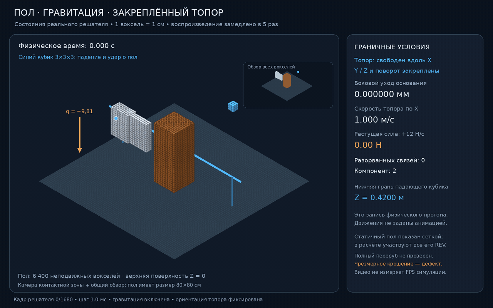

# Voxel Physics Lab

**Русский** | [English](README.md)

Экспериментальный проект на Rust для исследования механики воксельных материалов. Материя представлена репрезентативными элементарными объёмами (REV) размером 1 см, соединёнными направленными связями. Проект изучает, как контакт, ориентация материала, деформация и разрушение связей приводят к резанию и излому без специальных сценариев повреждения для конкретного инструмента. Это прототип, а не проверенный континуальный симулятор.

## Возможности и текущие результаты

- Древесные REV имеют локальную ориентацию волокон. Для примера с вертикальными волокнами (`Z`) таблица материала задаёт пределы связей вдоль волокон: 100 МПа на растяжение, 50 МПа на сжатие и 12 МПа на сдвиг; поперёк волокон — 2,5, 2 и 3 МПа соответственно. Жёсткость и работа образования поверхности излома также зависят от направления. Это демонстрационные параметры, не калибровка для конкретной породы.
- В тестах с управляемым перемещением для 10³ REV отношение параллельной и поперечной сил составляет 39,458 при растяжении и 32,539 при сжатии. Проверки связей включают реальные вертикальные и горизонтальные соседние элементы и пределы сдвига.
- Лезвие состоит из вокселей и имеет фаску шириной в один REV. Импульс при столкновении и трение нагружают тот же закон напряжений в связях, который применяется к другим материалам.
- Для любого подвижного вокселя доступны постоянные сила и ускорение в мировых координатах, разовый импульс и начальная скорость. Эти воздействия проходят через общий расчёт механики, разрешение контактов и разрушение связей. Для твёрдых групп можно задавать внешние силу и момент.
- Свободный REV под постоянной силой достигает 1,000 м/с за 100 мс с погрешностью не более `3.2×10⁻⁵ м/с`. Столкновение двух движущихся REV проходит без взаимного проникновения и сохраняет импульс.
- В модели есть теплопроводность между соседними REV. Пример с железным стержнем из 24 REV показывает сближение средних температур с 450/300 K до 375,093/374,907 K; относительное изменение полной внутренней энергии — `4.52×10⁻⁷`. Это не проверяет фазовые переходы или зависимость прочности от температуры.

Параметры и текущие контрольные результаты приведены в [таблице материалов](MATERIALS.md) и [статусе валидации](validation/STATUS.md).

## Демо резания


- [Видео контакта ножа](validation/knife-cut-demo.mp4) показывает ранний прототип начала контакта. Оно не демонстрирует полный разрез или проверенное движение объекта после удара.
- [Кадр начала резания](validation/knife-cut-final-frame.png).
- Короткая регрессионная проверка отдельно подтверждает полный разрез направляемым ножом образца древесины. Ограничения по обломкам и энергии описаны в [диагностике ножа](validation/knife-diagnosis.md).

Запись направляемого ножа сейчас нестабильна после разреза: при пилотном режиме 5,8 м/с и 200 Н к 0,37 с образуется 3243 фрагмента, даже после включения тормоза. Эти кадры служат диагностикой, а не итоговой проверенной демонстрацией резания. Образец изолирован: у него нет пола и гравитации, поэтому он не моделирует свободный замах топором или падение дерева.

Для просмотра сохранённой демонстрации с опорой, гравитацией и установленным на направляющей топором используйте [последнюю запись](#последняя-запись-симуляции). Она длится 0,21 с физического времени, содержит 22 кадра; расчёт занял 39,1 с. В этой записи направляющая не смещается, разрушенных связей нет. Это проверка устойчивости и производительности, а не полный разрез.

## Сборка и запуск

Нужны Rust 2021 и Cargo. Графический интерфейс использует необязательные зависимости `wgpu` и `winit`.

```sh
cargo run --release --bin voxel-physics-lab
```

Запуск механических проверок:

```sh
cargo test --no-default-features --lib
cargo test --no-default-features --bin physics_smoke_tests
cargo run --release --no-default-features --bin mechanical_tests -- tension
cargo run --release --no-default-features --bin mechanical_tests -- compression
cargo run --release --no-default-features --bin mechanical_tests -- knife
```

Полный набор механических сценариев содержит тест на изгиб, которому может не хватить памяти в ограниченной среде; для анализа запускайте сценарии отдельно.

### CUDA

Сборщик матрицы работает на CPU. Установленный CUDA-бэкенд может выполнять умножение разреженной матрицы на вектор, блочный предобуславливатель Якоби, обновление векторов и редукции на GPU. Выберите его переменной окружения `VOXEL_SOLVER_BACKEND=cuda`; значение `auto` пробует CUDA при наличии не менее 2048 активных REV. Если устройство недоступно или остаток не достигает заданного допуска, решатель использует CPU. Проверка разреженного оператора синтетическая и не измеряет скорость полной симуляции; целевые показатели 30 FPS на CPU и 60 FPS на GPU ещё не достигнуты.

## Примеры API

Публичный API `solver` принимает воздействия по индексу вокселя:

```rust
solver::set_force(&mut scene, voxel, Vec3::new(0.0, 0.0, 0.2)).unwrap();
solver::set_acceleration(&mut scene, voxel, Vec3::new(0.0, 0.0, -9.81)).unwrap();
solver::set_velocity(&mut scene, voxel, Vec3::new(1.0, 0.0, 0.0)).unwrap();
solver::apply_impulse(&mut scene, voxel, Vec3::new(0.0, 0.0, 0.01)).unwrap();
solver::clear_applied_actions(&mut scene, voxel).unwrap();
```

Сила и ускорение сохраняются между шагами решателя. Ускорение преобразуется в силу по текущей массе вокселя. Импульс меняет импульс тела один раз: `Δv = J / m`. Неподвижные воксели отклоняют эти воздействия.

Границы сцены удаляют вышедшие за них REV на границе фиксированного шага и записывают их массу, энергию и импульс в журнал удаления. Координаты задаются в метрах, оси `0/1/2` соответствуют `X/Y/Z`. Подробности есть в [справочнике материалов](MATERIALS.md) и английской версии README.

## Сцена с полом, гравитацией и опорами

По умолчанию графическое приложение загружает `scenes/mounted_axe.ron`: 4320 древесных REV, 6400 неподвижных элементов пола, гравитацию `(0, 0, -9.81)` м/с² и топор со скоростью 1 м/с. Поверхность пола находится на `Z=0`. Нижний слой ствола закреплён через кинематический API.

Топор установлен на линейной направляющей: он перемещается вдоль выбранного направления удара, но не смещается в стороны и не вращается. Направляющая и основание показаны синим и сами не являются телом контакта. Это скользящая опора, а не шарнир для замаха. Гравитация действует на свободные инструменты, древесину и фрагменты.

## Структура проекта

- `src/scene.rs`, `src/voxel.rs`, `src/material.rs` — состояния REV, состав, ориентация микроструктуры, таблица материалов и фаза по энтальпии.
- `src/bond.rs`, `src/fracture.rs` — связи с шестью соседями, разрушение при сложной нагрузке, пластичность, усталость и учёт энергии.
- `src/solver.rs`, `src/collision.rs`, `src/tool.rs` — связанная механика, контакты без проникновения и воксельные твёрдые инструменты.
- `src/experiments.rs`, `src/bin/` — воспроизводимые механические тесты и проверки контакта.
- `scenes/wood_chop.ron` — размеры, направление волокон, гравитация и настройки решателя.
- `validation/` — заметки о проверках, записи и демонстрационные материалы.

## Ограничения

Решатель моделирует уменьшенную активную область. Таблица материалов небольшая и иллюстративная; ещё нужно проверить свойства разных пород дерева, влажность, калибровку энергии разрушения, независимые столкновения фрагментов и производительность больших сцен в реальном времени. Сцена на 299 440 вокселей занимает 16–17 секунд на один шаг решателя в релизной сборке. Это значительно медленнее цели 10 FPS. При долгом ударе повреждение может распространяться слишком широко.

Текущие неудачные и успешные результаты, настройки и ограничения фиксируются в [статусе валидации](validation/STATUS.md), [диагностике ножа](validation/knife-diagnosis.md) и отчётах в `validation/`. Столкновение само по себе не моделирует сварку металлов; термическое соединение, диффузия и образование сплавов не реализованы.

## Последняя запись симуляции

Текущая GIF-анимация показывает 22 равномерно распределённых состояния из запуска решателя на 210 шагов:



Запись охватывает 0,21 с симуляции и 2,2 с видео при 10 FPS. Она проверяет работу решателя с включённым теплообменом и равномерной начальной температурой, но не проверяет ненулевой тепловой поток или его энергетический баланс.

Чтобы открыть локальный просмотрщик и записать новый запуск:

```sh
python3 validation/live_viewer.py --host 0.0.0.0 --port 8765 --csv validation/live-support.csv --label "Mounted axe and gravity"
RUSTUP_HOME="$PWD/.toolchain/rustup" CARGO_HOME="$PWD/.toolchain/cargo" RAYON_NUM_THREADS=1 ./.toolchain/cargo/bin/cargo run --release --no-default-features --bin support_capture -- validation/live-support.csv 210 22
```

Откройте <http://127.0.0.1:8765>. Просмотрщик показывает новые кадры во время расчёта; GIF доступен по `/gif`, а MP4 — по `/video`, если он был создан локально.
